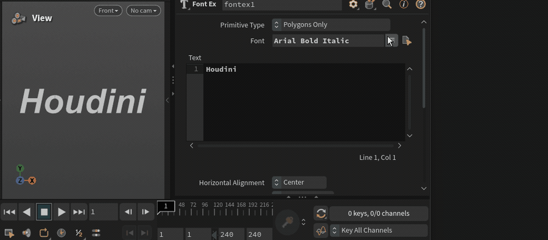

# Font Ex（`kickbase::fontex`）

Houdini の Font SOP 向け Digital Asset。**フォントメニューを開いたときに Qt の一覧を出し、行ホバーでビューポートをプレビュー、クリックで確定**します。実装の大部分は HDA の `PythonModule`（`src/kb_fontex_hda.py` と同内容）に集約しています。

## ダウンロード

**HDA の正式な配布先は [GitHub Releases](https://github.com/kickbase/houdini-font-ex/releases) の最新版**です。添付は `.hda` のみです。

[Release v0.01](https://github.com/kickbase/houdini-font-ex/releases/tag/v0.01) から `kickbase--fontex-0.01.hda` を取得するか、本リポジトリの [`release/kickbase--fontex-0.01.hda`](release/kickbase--fontex-0.01.hda) を利用してください。

## ソースコード

実装は [`src/kb_fontex_hda.py`](src/kb_fontex_hda.py)（および `src/fileparm.py` など）が HDA 埋め込みと同内容です。タグ付きの参照例: [`v0.01` の `kb_fontex_hda.py`](https://github.com/kickbase/houdini-font-ex/blob/v0.01/src/kb_fontex_hda.py)。

## インストール

1. Houdini で **File → Install Digital Asset Library…** から `.hda` を選ぶ
2. タブメニューなどから `kickbase::fontex` を作成
3. パラメータ **Font**（`file`）右のメニューを開き、一覧でホバー／クリックしてフォントを選ぶ

Esc や一覧外クリックで閉じた場合は、一覧を開く前のフォントに戻ります。

## リポジトリ構成

| パス | 内容 |
| --- | --- |
| `release/*.hda` | 読者向け配布物（Release 添付と同じ） |
| `src/` | HDA 埋め込みスクリプトの写し |
| `img/font-ex.gif` | README 用の操作デモ |

## 動作環境

- SideFX Houdini **21.0.x** 想定（UI あり・`hou.isUIAvailable()`）
- Windows での動作確認あり（他 OS は未検証でも動く可能性はあります）

## ライセンス

[MIT](LICENSE)

## 解説記事

Zenn（Houdini Advent Calendar 2026 予定）: 記事公開後に URL を追記します。

リポジトリ: https://github.com/kickbase/houdini-font-ex
